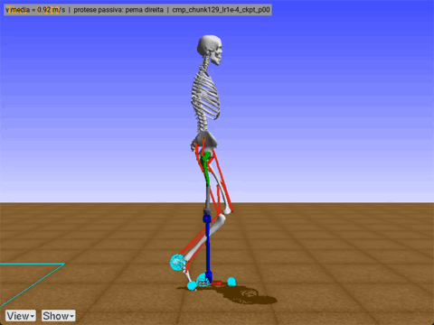
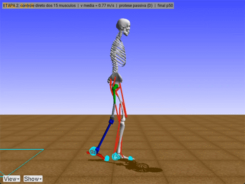

# RL_OSim: marcha de amputado transfemoral com RL e dinâmica direta OpenSim/MATLAB

  
  

**Etapa 2 (à direita):** o agente comanda sozinho os 15 músculos, sem controlador-base (β = 0). Ele anda 0,77 m/s por 20 s, e 30% do ciclo fica dentro de ± 1 DP do dataset. O vídeo completo está em [`final_p50_opensim.mp4`](etapa2_FD_prothesis_Dataset/results/final_p50_opensim.mp4).

**Etapa 1 (à esquerda):** o melhor agente da etapa 1 anda no visualizador do OpenSim. A perna direita tem prótese passiva, e a velocidade média é de 0,92 m/s. O vídeo completo, com 20 s, está em [`cmp_chunk129_lr1e-4_ckpt_p00_opensim.mp4`](etapa1_FD_prothesis_Literature/results/cmp_chunk129_lr1e-4_ckpt_p00_opensim.mp4). Há também a [versão em bonecos de palito](etapa1_FD_prothesis_Literature/results/cmp_chunk129_lr1e-4_ckpt_p00_marcha.mp4) e o [relatório técnico em PDF](etapa1_FD_prothesis_Literature/docs/relatorio_tecnico.pdf).

As duas etapas compartilham:
- `OpenSIM/`: o modelo `OS4_gait14dof15musc_2Act_RTFP_DynAct.osim` e a geometria;
- `data/wbds/`: o dataset de Fukuchi et al. (2018, CC BY 4.0).

| Pasta | Etapa |
|---|---|
| `etapa1_FD_prothesis_Literature/` | Referência de marcha da literatura. O agente SAC aplica um resíduo sobre o controlador-base. Contém o relatório técnico (`docs/`), os agentes e os resultados da etapa 1. |
| `etapa2_FD_prothesis_Dataset/` | Referência e variabilidade (± 1 DP) medidas no dataset. O agente passa a comandar diretamente os 15 músculos, com o controlador-base retirado por currículo. |
