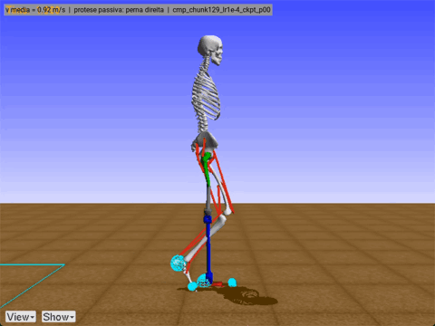
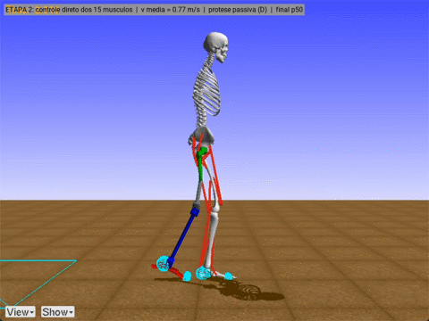
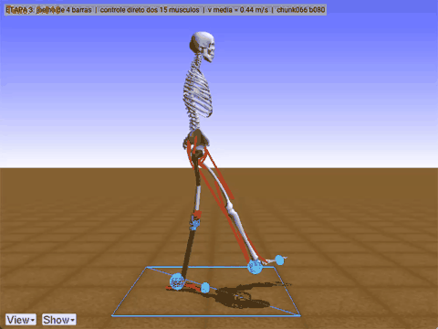

# RL_OSim: marcha de amputado transfemoral com RL e dinâmica direta OpenSim/MATLAB

  
  

  

**Etapa 3 (abaixo): joelho policêntrico de 4 barras.** O modelo é `OpenSIM/50_Direita_Final.osim`, com o mesmo método da etapa 2. O vídeo mostra o agente do bloco 66 com β = 0,8: o controlador-base ainda contribui com 80% da excitação. Ele anda 0,44 m/s por 10 s. O vídeo completo está em [`chunk066_b080_opensim.mp4`](etapa3_FD_prothesis_4barras/results/chunk066_b080_opensim.mp4). O treino chegou a β = 0 no bloco 116 de 120, mas a seleção final e o vídeo com controle muscular direto ainda não foram feitos.

**Etapa 2 (acima, à direita):** o agente comanda sozinho os 15 músculos, sem controlador-base (β = 0). Ele anda 0,77 m/s por 20 s, e 30% do ciclo fica dentro de ± 1 DP do dataset. O vídeo completo está em [`final_p50_opensim.mp4`](etapa2_FD_prothesis_Dataset/results/final_p50_opensim.mp4).

**Etapa 1 (acima, à esquerda):** o melhor agente da etapa 1 anda no visualizador do OpenSim. A perna direita tem prótese passiva, e a velocidade média é de 0,92 m/s. O vídeo completo, com 20 s, está em [`cmp_chunk129_lr1e-4_ckpt_p00_opensim.mp4`](etapa1_FD_prothesis_Literature/results/cmp_chunk129_lr1e-4_ckpt_p00_opensim.mp4). Há também a [versão em bonecos de palito](etapa1_FD_prothesis_Literature/results/cmp_chunk129_lr1e-4_ckpt_p00_marcha.mp4) e o [relatório técnico em PDF](etapa1_FD_prothesis_Literature/docs/relatorio_tecnico.pdf).

Todas as etapas usam a mesma interface de dinâmica direta: o OpenSim avalia ẏ e o `ode23` do MATLAB integra. Elas compartilham:
- `OpenSIM/`: os modelos e a geometria. As etapas 1 e 2 usam `OS4_gait14dof15musc_2Act_RTFP_DynAct.osim` (joelho protético monocêntrico, de pino). As etapas 3 e 4 usam `50_Direita_Final.osim` (joelho policêntrico de 4 barras), com os pés corrigidos para não penetrar o solo;
- `data/wbds/`: o dataset de Fukuchi et al. (2018, CC BY 4.0), usado nas etapas 2 e 3.

| Pasta | Etapa |
|---|---|
| `etapa1_FD_prothesis_Literature/` | Referência de marcha da literatura. O agente SAC aplica um resíduo sobre o controlador-base. Contém o relatório técnico (`docs/`), os agentes e os resultados da etapa 1. |
| `etapa2_FD_prothesis_Dataset/` | Referência e variabilidade (± 1 DP) medidas no dataset. O agente passa a comandar diretamente os 15 músculos, com o controlador-base retirado por currículo. |
| `etapa3_FD_prothesis_4barras/` | Mesmo método da etapa 2, com o joelho policêntrico de 4 barras. A observação e a recompensa usam a flexão real coxa-perna, obtida da tabela do mecanismo (`src/fourBarMap.m`). A avaliação grava a trajetória do CIR (centro instantâneo de rotação) sincronizada com a fase do ciclo e com a força de reação do solo. `src/compare_cir_asym.m` compara o CIR e a assimetria (SI) com a prótese de pino da etapa 2. |
| `etapa4_FD_prothesis_4barras_SemDataset/` | Joelho de 4 barras **sem dataset** (treino em andamento). Não há controlador-base, e a referência sai da observação. A recompensa usa só plausibilidade fisiológica: velocidade de caminhada (0,9–1,3 m/s), tronco ereto, passos alternados e simétricos, custo metabólico, amplitudes articulares fisiológicas, pico de GRF ≤ 1,5 PC e nenhuma fase de voo. Os estados iniciais são sorteados de marchas simuladas na etapa 3. |
